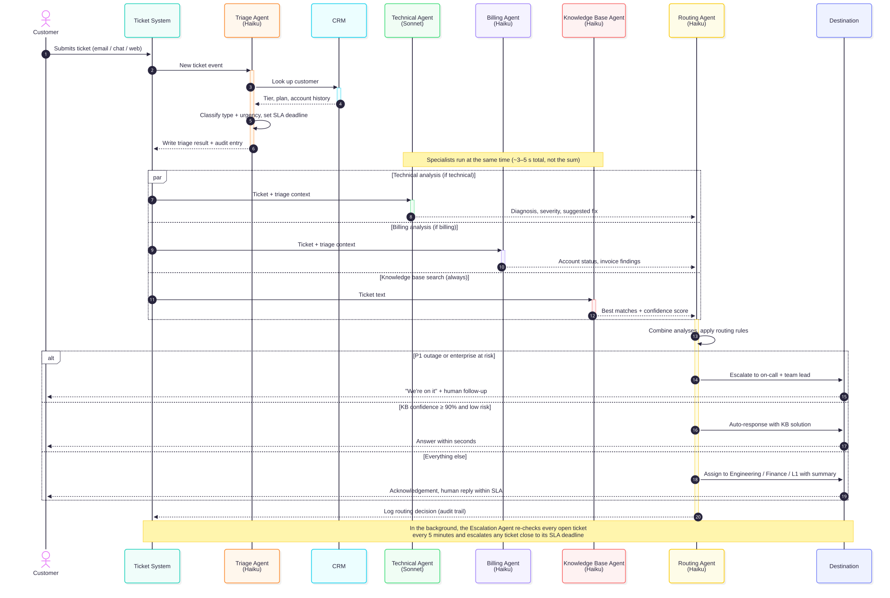

# Customer Support Ticket Routing System Architecture

Design a multi-agent system for intelligent customer support ticket handling.

## Problem Statement

Your SaaS company receives 5,000+ support tickets daily across email, chat, and web forms. Current process:
- All tickets go to L1 support
- Manual categorization and routing
- Average response time: 4 hours
- Enterprise SLA: 1 hour (frequently missed)

**Goal**: Intelligent system that automatically triages, routes, and resolves tickets.

---

## Requirements Analysis

### Functional Requirements
- Triage tickets by urgency and complexity
- Route technical issues to engineering
- Route billing issues to finance
- Prioritize by customer tier (enterprise vs. standard)
- Search knowledge base for similar solved issues
- Auto-respond to common questions
- Escalate unresolved issues to humans with context

### Non-Functional Requirements
- Enterprise SLA: < 1 hour response
- Standard SLA: < 4 hour response
- Handle 5,000+ tickets/day
- 95% routing accuracy
- Audit trail for all decisions

---

## Option A: Single Agent Approach

### Pros
- Simple implementation
- Single context (all info in one place)
- Easy to debug

### Cons
- Sequential processing (slow)
- Can't handle parallel tickets efficiently
- One agent doing too many things
- Hard to specialize for different ticket types

### Estimated Performance
- Processing time: 30-60 seconds per ticket
- Daily capacity: ~2,500 tickets (with queuing)
- SLA compliance: ~70%

---

## Option B: Multi-Agent Approach (Recommended)

My design splits the work into six small agents, each with one job. A fast Triage Agent looks at every ticket first. Three specialists (Technical, Billing, Knowledge Base) then analyze it **at the same time**, and a Routing Agent combines their findings to pick the destination. A sixth agent, the Escalation Agent, runs in the background and watches the clock on every open ticket so nothing quietly breaches its SLA.

### Agent Definitions

| Agent | Responsibility | Tools | Model | Parallel? |
|-------|---------------|-------|-------|-----------|
| **Triage Agent** | Entry point for every ticket. Classifies type (technical / billing / general) and urgency (P1–P4), looks up the customer, and sets the SLA deadline from their tier (1 h enterprise, 4 h standard). | CRM (customer lookup), Ticket System | Haiku: a short classification task on every ticket, so speed and cost matter most | No. Runs first, everything else depends on it |
| **Technical Agent** | Diagnoses technical issues: bugs, outages, integration and API errors. Produces a likely root cause, a severity, and a suggested fix for the engineer. | Log search, Status page, Known-issues tracker | Sonnet: the one task that needs real reasoning over logs and error messages | Yes. Runs alongside Billing and KB (only for technical tickets) |
| **Billing Agent** | Handles payment and account questions: invoices, refunds, failed charges, plan changes. Pulls the facts so Finance doesn't have to. | Billing system, Subscription records | Haiku: mostly structured lookups with simple rules | Yes. Runs alongside Technical and KB (only for billing tickets) |
| **Knowledge Base Agent** | Always runs. Searches the KB and previously solved tickets for a matching answer and returns a confidence score. | KB vector search, Resolved-ticket history | Haiku: retrieval plus a quick relevance judgment | Yes. Runs on every ticket, alongside the specialists |
| **Routing Agent** | Combines triage and all analyses, applies the routing rules, and sends the ticket to auto-response, the right human queue, or escalation. Attaches a short context summary so humans never start from zero. | Ticket System, Team queues, Email (auto-replies) | Haiku: rule-guided decision over already-structured inputs | No. Waits for the parallel step to finish |
| **Escalation Agent** | Background SLA monitor. Every 5 minutes it checks time remaining on every open ticket and alerts or escalates before a breach happens. | Ticket System, Slack / Email alerts, Paging, Audit log | Haiku: simple, frequent checks where cost adds up | Yes. Runs independently of the ticket pipeline |

All agents write their decisions to a shared audit log, which covers the "audit trail for all decisions" requirement.

### Pros

- **Much faster per ticket.** Specialists run in parallel, so total time is roughly triage + the slowest specialist + routing, not the sum of every step.
- **Scales horizontally.** Each agent is stateless and can be scaled on its own. If technical tickets spike, I add Technical Agent workers without touching anything else.
- **Specialization improves accuracy.** Each agent has a narrow prompt and only the tools it needs, which makes it easier to get right and to evaluate.
- **Right model for each job.** Only the Technical Agent uses Sonnet; everything else runs on Haiku, which keeps cost per ticket low at 5,000+ tickets a day.
- **Proactive SLA protection.** The background Escalation Agent catches at-risk tickets instead of finding out after the breach.
- **Easy to extend.** Adding, say, a Security or Sales agent means adding one box to the parallel step and one rule to the Routing Agent.
- **Graceful degradation.** If one specialist fails, the others still produce results and the ticket can still be routed (see Failure Mode Analysis).

### Cons

- **More moving parts.** Six agents, queues, and timeouts are harder to build, deploy, and monitor than one agent.
- **Harder to debug.** A bad routing decision could come from any of four upstream agents, so good tracing and the audit log become essential.
- **Context handoff risk.** Each agent only sees what it is given. If triage passes the wrong context, downstream agents inherit the mistake.
- **Coordination overhead.** The parallel step needs timeouts and result merging, and a slow agent can hold up routing.
- **Higher infrastructure cost** than a single agent, although cheaper models for most steps offset much of the model cost.

### Estimated Performance

- Processing time: **5–10 seconds** per ticket (triage ~1–2 s, parallel analysis ~3–5 s, routing ~1–2 s)
- Daily capacity: **50,000+ tickets** with horizontal scaling (10x the current volume)
- Auto-resolution rate: **~40%**
- SLA compliance: **98%+**

---

## Workflow Diagram

The full journey of a ticket. Dashed arrows show the parallel step. The three exits are auto-response (~40%), a human team (~55%), and escalation (~5%). Auto-replied tickets that the customer reopens fall back to a human, and the background Escalation Agent keeps watching anything still open.

### Sequence Diagram

The same flow as a timeline. The `par` block shows the three specialists working at the same time, and the `alt` block shows the three routing outcomes.

---

## SLA Monitoring (Background)

The Escalation Agent is separate from the ticket pipeline on purpose: routing a ticket correctly doesn't guarantee someone answers it in time.

- **Runs:** every 5 minutes, on a scheduler.
- **Checks:** every open ticket that hasn't had a human reply yet, comparing time remaining against its SLA window (1 h enterprise, 4 h standard).
- **Thresholds:**
  - More than 50% of the window left: on track, no action.
  - 20–50% left: warning. Bump its queue priority and notify the assigned agent.
  - Less than 20% left: at risk. Alert the team lead on Slack and reassign if the owner is busy. For enterprise customers, also page on-call and notify the account manager.
  - Breached: escalate to the support manager and log a compliance violation.
- **Tools:** Ticket System, Slack / Email, Paging, Audit log.
- **Model:** Haiku. The checks are simple and frequent, so a fast, cheap model is the right fit.
- **Watching the watcher:** each run writes a heartbeat. If no heartbeat appears for 10 minutes, a dead-man's switch alerts ops and fails over to a backup monitor.

---

## Failure Mode Analysis

| Failure | Impact | Mitigation |
|---------|--------|------------|
| **Triage Agent down** | No ticket gets classified, so nothing reaches the specialists or routing. The whole pipeline stalls. | Fall back to **round-robin assignment to human L1 agents** so tickets keep moving. Run multiple Triage instances behind a health check and alert on-call. |
| **CRM unavailable** | Triage can't tell enterprise from standard customers, so SLA deadlines and priorities may be wrong. | **Treat every ticket as high-priority enterprise** (1 h SLA) until the CRM is back. Over-serving standard customers for a while is far cheaper than missing an enterprise SLA. Cache recent lookups to soften the impact. |
| **Knowledge Base search fails** | No confidence score, so auto-responses could be wrong or missing. | **Disable auto-response and route everything to humans** while KB is down. The other specialists still run, so humans still get context. |
| **Escalation Agent crashes** | At-risk tickets are no longer flagged, so SLA breaches can happen silently. | **Dead-man's switch:** if no heartbeat for 10 minutes, alert ops and start a backup monitor. Ticket-level SLA timers in the Ticket System act as a last safety net. |
| **Technical Agent slow / timeout** | Routing waits on the slowest specialist, delaying every technical ticket. | 30-second timeout per specialist. On timeout, route anyway to the Engineering queue with whatever triage and KB found, flagged "diagnosis pending". |
| **Model API rate limits or outage** | Agents fail or slow down across the board during peaks. | Queue with retries and exponential backoff, a fallback model, and priority lanes so enterprise and P1 tickets are processed first. |
| **Routing Agent makes a wrong call** | A ticket lands in the wrong queue or gets an incorrect auto-reply, hurting customer trust. | High confidence bar (≥ 90%) for auto-replies, a "reopen → human" path, sampling of decisions from the audit log, and humans can re-route with one click (which feeds back into evaluation). |

---

## Recommendation

**Choose Option B (multi-agent) because:**

1. **Volume.** At 5,000+ tickets a day, the single agent tops out around 2,500 with queuing. Because each agent can be scaled independently, the multi-agent design handles 50,000+ and leaves room for growth.
2. **Speed and the 1-hour SLA.** Running the specialists in parallel brings processing down from 30–60 seconds to 5–10 seconds per ticket. Combined with the background Escalation Agent, that is what makes the enterprise SLA reliably reachable instead of "frequently missed."
3. **Specialization.** Technical and billing problems need different tools and different depth. Giving each its own agent, prompt, and tools makes each one more accurate and easier to test, which supports the 95% routing-accuracy target.
4. **Cost vs. benefit.** Only the Technical Agent needs Sonnet; the rest run on Haiku. Auto-resolving ~40% of tickets frees human agents to focus on the hard ones, which more than pays for the extra infrastructure.
5. **Resilience and extensibility.** Failures degrade gracefully (each one has a fallback above), and new ticket types can be added as new agents without redesigning the system.

### Estimated Performance

- Processing time: **5–10** seconds per ticket
- Daily capacity: **50,000+** tickets
- Auto-resolution rate: **~40%**
- SLA compliance: **98%+**

| Metric | Today (manual) | Option A (single agent) | Option B (multi-agent) |
|--------|---------------|------------------------|------------------------|
| Response / processing time | ~4 hours | 30–60 s | 5–10 s |
| Daily capacity | limited by staff | ~2,500 | 50,000+ |
| SLA compliance | frequently missed | ~70% | 98%+ |

---

## Key Takeaways

1. **Decompose by responsibility, not by step.** Each agent owns one clear job with only the tools it needs. That made the design easier to reason about, test, and scale.

2. **Parallelism is where the speed comes from.** Once triage is done, the specialists don't depend on each other, so running them together cuts processing time to roughly the slowest one.

3. **Match the model to the task.** Fast, cheap models (Haiku) handle classification, lookups, and routing; the more capable model (Sonnet) is reserved for complex technical analysis. That keeps cost under control at high volume.

4. **Design for failure from the start.** Every critical component needs a fallback that fails *safe*: round-robin to humans, treat unknown customers as enterprise, turn off auto-replies when unsure, and watch the watcher with a dead-man's switch.
